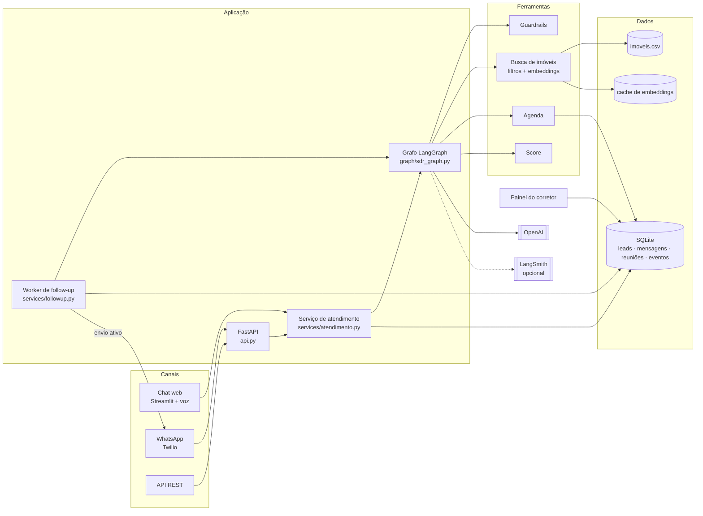
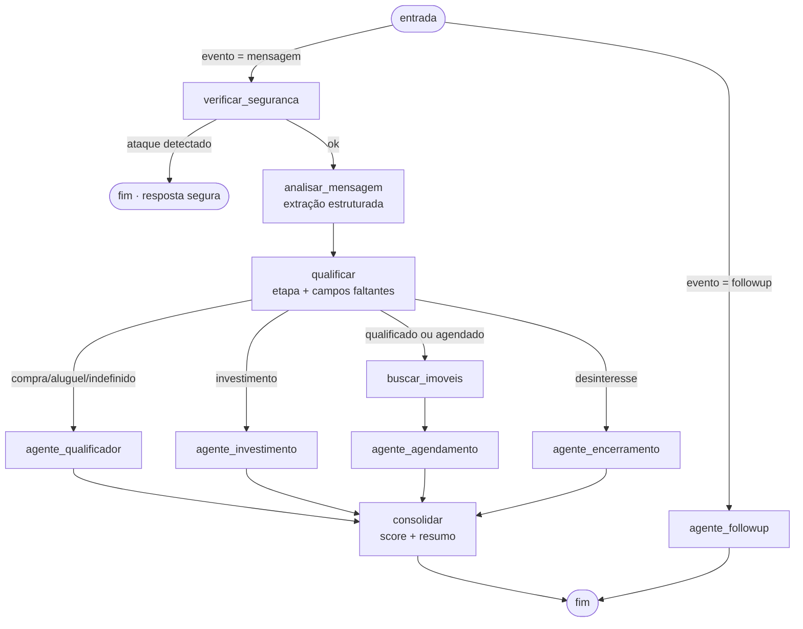
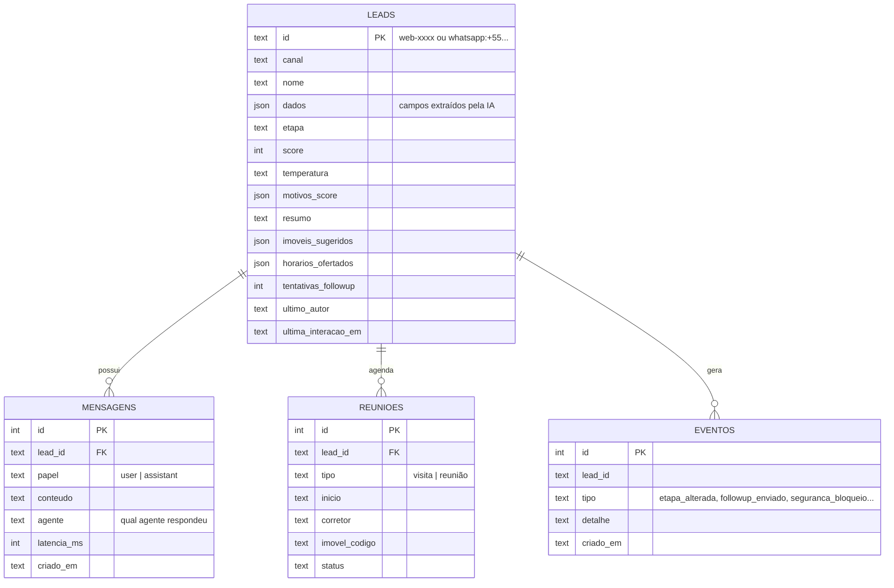
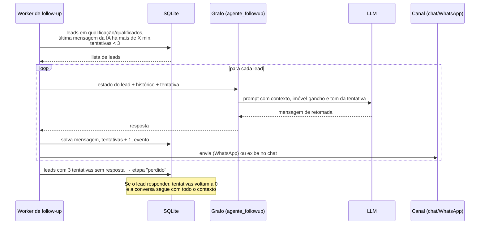

# Arquitetura da solução

## Visão geral

A solução separa **canais**, **orquestração de IA**, **ferramentas** e **dados**. Qualquer canal (chat web, WhatsApp, API) chama o mesmo serviço de atendimento, que monta o estado do lead a partir do banco, executa o grafo de agentes e persiste o resultado. O follow-up é um processo independente que reaproveita o mesmo grafo.

| Camada | Responsabilidade | Arquivos |
|---|---|---|
| Canais | Receber e entregar mensagens | `ui/atendimento.py`, `api.py`, `src/channels/whatsapp.py` |
| Serviços | Carregar o estado do lead, executar o grafo, persistir, registrar eventos | `src/services/atendimento.py`, `src/services/followup.py` |
| Orquestração | Decidir qual agente responde e com qual contexto | `src/graph/` |
| Ferramentas | Funções determinísticas usadas pelos agentes | `src/tools/`, `src/services/score.py`, `src/security/` |
| Dados | Memória conversacional, CRM e base de imóveis | `src/memory/repositorio.py`, `src/data/` |
| Painel | Visão do corretor (somente leitura + ações de demo) | `ui/dashboard.py` |

## O grafo de agentes

| Nó | Tipo | O que faz |
|---|---|---|
| `verificar_seguranca` | Determinístico | Detecta prompt injection; se houver, encerra com resposta segura sem chamar o LLM |
| `analisar_mensagem` | LLM (structured output) | Extrai intenção, dados do lead e sinais da última mensagem (escolha de horário, recusa, desinteresse) |
| `qualificar` | Determinístico | Calcula os campos que faltam e a etapa: novo → em qualificação → qualificado → agendado / perdido |
| `buscar_imoveis` | Ferramenta (RAG) | Recupera até 3 imóveis aderentes ao perfil; só refaz a busca se os critérios mudarem |
| `agente_qualificador` | LLM | Conduz compra/aluguel: região, valor, quartos, urgência |
| `agente_investimento` | LLM | Especialista: perfil, ticket, retorno esperado |
| `agente_agendamento` | LLM + ferramenta | Apresenta imóveis, oferece horários, grava a reunião, lida com recusa e pedido de outro horário |
| `agente_encerramento` | LLM | Encerra com gentileza quando o lead não tem interesse |
| `agente_followup` | LLM | Gera a mensagem de retomada com contexto e gancho |
| `consolidar` | Determinístico + LLM | Recalcula o score; gera o resumo para o corretor quando o lead muda para qualificado ou agendado |

**Por que um grafo e não um único prompt?** Cada agente tem um prompt pequeno e focado (melhor qualidade e menos alucinação), as decisões de fluxo são código testável (não dependem do LLM) e é simples incluir novos agentes, por exemplo de pós-venda.

**Por que extração + resposta em chamadas separadas?** A extração usa temperatura 0 e um esquema Pydantic validado; a resposta usa temperatura 0,6 para soar natural. A extração alimenta o score, a busca, a agenda e o painel, e o texto da conversa nunca precisa ser interpretado por regex.

## Modelo de dados

A restrição `UNIQUE(inicio, corretor)` em `reunioes` impede dois agendamentos no mesmo horário para o mesmo corretor, mesmo com acessos simultâneos.

## Sequência: follow-up automático

## Escalabilidade

| Hoje (POC) | Caminho para produção |
|---|---|
| SQLite com WAL, uma conexão por operação | PostgreSQL; o `Repositorio` é a única classe que acessa dados |
| Worker de follow-up em loop | Job agendado (cron, Cloud Scheduler) ou fila (SQS, Celery) |
| Grafo stateless por requisição | Escala horizontal: várias réplicas da API atrás de um load balancer, porque todo o estado está no banco |
| Embeddings em arquivo | Banco vetorial (pgvector) quando a base passar de alguns milhares de imóveis |
| Uma imobiliária | Multi-tenant: `tenant_id` nas tabelas e persona/políticas por tenant (já parametrizadas por variáveis de ambiente) |

## Segurança e privacidade

- **Entrada:** limite de 1.500 caracteres, remoção de caracteres de controle e de CPF/cartão antes de qualquer processamento.
- **Prompt injection:** detecção por padrões (PT e EN) antes do LLM; a mensagem bloqueada não entra no histórico enviado ao modelo.
- **Prompt:** o agente não pode inventar imóveis ou condições, não pede documentos e não revela instruções.
- **Logs:** e-mail, telefone, CPF e cartão são mascarados por um filtro de logging; o LangSmith recebe o lead identificado por hash.
- **API:** token Bearer opcional (`API_TOKEN`); o webhook do WhatsApp valida a assinatura HMAC do Twilio.
- **LGPD:** o lead pode pedir para não ser contatado (sinal `desinteresse`), o que encerra a conversa e suspende o follow-up.
